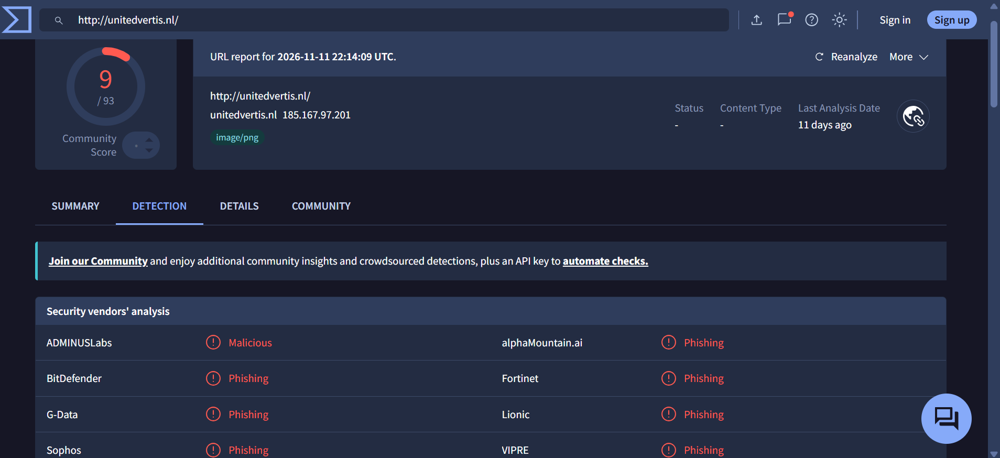
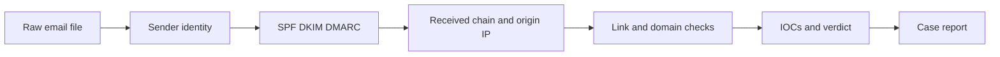

# Phishing Email Analysis

SOC-style analysis of real phishing emails. For each sample I examine the raw
headers, trace the sending infrastructure, check links and domains against
reputation sources, extract indicators of compromise (IOCs), and write a case
report with a recommended response.

**Quick links:** [Cases](#cases) | [Workflow](#workflow) | [Skills shown](#skills-shown) | [Roadmap](#roadmap) | [Safety](#safety)

## Cases

| Case | Lure | Verdict | Severity | Report |
|---|---|---|---|---|
| 01 | Fake OKX Web3 extension promotion | Phishing (brand impersonation) | Medium | [Read report](cases/case-01.md) |
| 02 | Fake Visa World Cup prize promotion | Phishing (brand impersonation) | Medium | [Read report](cases/case-02.md) |
| 03 | Casino promotion sent through Firebase | Malicious spam (abuse of a trusted service) | Low | [Read report](cases/case-03.md) |

<b>Case 01 at a glance (click to expand)</b>

- **Lure:** email promoting a fake "OKX Web3 Extension" install
- **Sender trick:** display name says OKX, real address is an unrelated company domain
- **Authentication:** SPF none, DKIM fail, DMARC none
- **Origin:** rented hosting server in Russia, relayed through a Shanghai company mail server
- **Link trick:** Cyrillic lookalike characters in the extension name
- **Finding:** the relaying company's domain is 21 years old, so its mail system was most likely misused, not the attacker's own
- **Limit:** the extension page was already unavailable, so the payload was not inspected

<b>Case 02 at a glance (click to expand)</b>

- **Lure:** fake Visa promotion for the 2026 World Cup with cash prizes up to R$ 100,000
- **Sender trick:** the address has no real domain after the "@", so it cannot belong to Visa
- **Authentication:** SPF none, DKIM none (message not signed), DMARC none
- **Origin:** a single rented cloud server in London, sent straight to Microsoft
- **Link trick:** the button points to a Google Cloud Run address, not a Visa domain
- **Finding:** Microsoft scored it SCL 7 and sent it to Junk
- **Limit:** the landing page returned 404 when scanned, so its content was not inspected

<b>Case 03 at a glance (click to expand)</b>

- **Lure:** German casino welcome offer ("100% up to 3500 EUR + 200 free spins")
- **Sender trick:** a Firebase project address that anyone can create
- **Authentication:** SPF pass, DKIM pass, DMARC permerror
- **Origin:** Google's own mail servers
- **Key lesson:** the email passed authentication and was still abusive, because SPF and DKIM prove who sent a message, not that the content is honest
- **Link trick:** every clickable part goes to a different domain, flagged by 9 vendors on VirusTotal
- **Limit:** the link domain stopped resolving before it could be inspected

## Workflow

<b>Method in detail (click to expand)</b>

1. Read raw headers in a text editor (never open the email in a mail client)
2. Check sender identity: From, Return-Path, Reply-To, decoded display name
3. Check SPF, DKIM and DMARC results
4. Trace the Received chain and identify the originating IP
5. Check sender-side IPs on AbuseIPDB, links on VirusTotal and urlscan.io, domain age via WHOIS where a real domain exists
6. Extract IOCs (defanged) and write the report with limitations stated

## Skills shown

| Skill | Where |
|---|---|
| Email header forensics | Every case |
| SPF, DKIM, DMARC interpretation | Every case |
| Judging emails that pass authentication | Case 03 |
| Identifying the true sending server in the Received chain | Every case |
| IOC extraction and defanging | Every case |
| Threat intelligence lookups | AbuseIPDB, VirusTotal, urlscan.io, WHOIS |
| Choosing what not to block (shared infrastructure) | Cases 01 and 03 |
| Honest reporting of limits | Limitations section in each report |

## Roadmap

- [x] Case 01: brand impersonation with a lookalike link
- [x] Case 02: fake prize promotion with a sender that has no real domain
- [x] Case 03: authenticated email abusing a trusted service
- [ ] Case 04: email with an attachment (hash lookup)
- [ ] Python script to extract headers, IPs and URLs from .eml files

## Tools

Text editor, base64 decoding, AbuseIPDB, VirusTotal, urlscan.io, WHOIS (CNNIC)

## Safety

- Samples come from the public Phishing Pot research collection
- No raw emails or attachments are published in this repository
- All URLs and domains are defanged
- Links were never opened in a browser
- Query strings and codes that identify a recipient were removed before scanning
