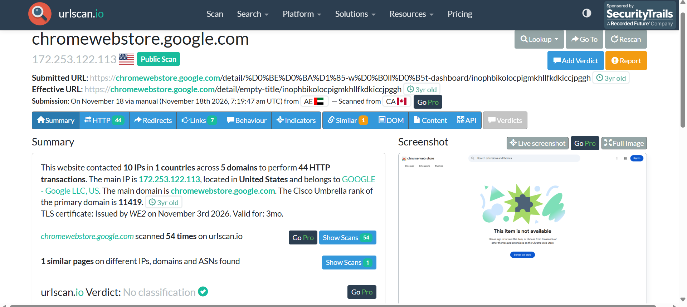
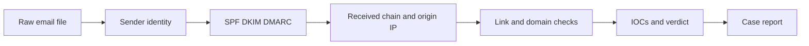

# Phishing Email Analysis

SOC-style analysis of real phishing emails. For each sample I examine the raw
headers, trace the sending infrastructure, check links and domains against
reputation sources, extract indicators of compromise (IOCs), and write a case
report with a recommended response.

**Quick links:** [Cases](#cases) | [Workflow](#workflow) | [Skills shown](#skills-shown) | [Safety](#safety)

## Cases

| Case | Lure | Verdict | Severity | Report |
|---|---|---|---|---|
| 01 | Fake OKX Web3 extension promotion | Phishing (brand impersonation) | Medium | [Read report](cases/case-01.md) |

<b>Case 01 at a glance (click to expand)</b>

- **Lure:** email promoting a fake "OKX Web3 Extension" install
- **Sender trick:** display name says OKX, real address is an unrelated company domain
- **Authentication:** SPF none, DKIM fail, DMARC none
- **Origin:** rented hosting server in Russia, relayed through a Shanghai company mail server
- **Link trick:** Cyrillic lookalike characters in the extension name
- **Finding:** the relaying company's domain is 21 years old, so its mail system was most likely misused, not the attacker's own
- **Limit:** the extension page was already unavailable, so the payload was not inspected

## Workflow

<b>Method in detail (click to expand)</b>

1. Read raw headers in a text editor (never open the email in a mail client)
2. Check sender identity: From, Return-Path, Reply-To, decoded display name
3. Check SPF, DKIM and DMARC results
4. Trace the Received chain and identify the originating IP
5. Check IPs on AbuseIPDB, links on VirusTotal and urlscan.io, domain age via WHOIS
6. Extract IOCs (defanged) and write the report with limitations stated

## Skills shown

| Skill | Where |
|---|---|
| Email header forensics | Every case |
| SPF, DKIM, DMARC interpretation | Every case |
| IOC extraction and defanging | Every case |
| Threat intelligence lookups | AbuseIPDB, VirusTotal, urlscan.io, WHOIS |
| Honest reporting of limits | Limitations section in each report |

## Roadmap

- [x] Case 01: brand impersonation with lookalike link
- [ ] Case 02: fake login page (credential harvesting)
- [ ] Case 03: email with an attachment
- [ ] Python script to extract headers, IPs and URLs from .eml files

## Tools

Text editor, base64 decoding, AbuseIPDB, VirusTotal, urlscan.io, WHOIS (CNNIC)

## Safety

- Samples come from the public Phishing Pot research collection
- No raw emails or attachments are published in this repository
- All URLs and domains are defanged
- Links were never opened in a browser
