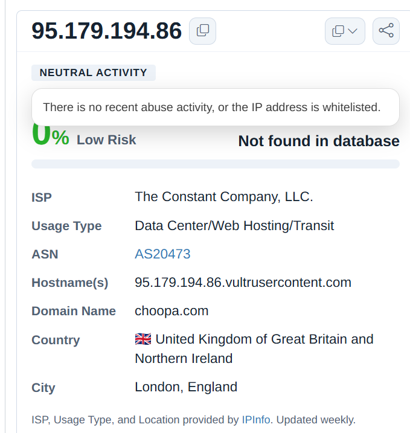
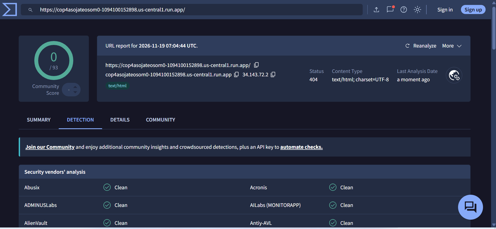
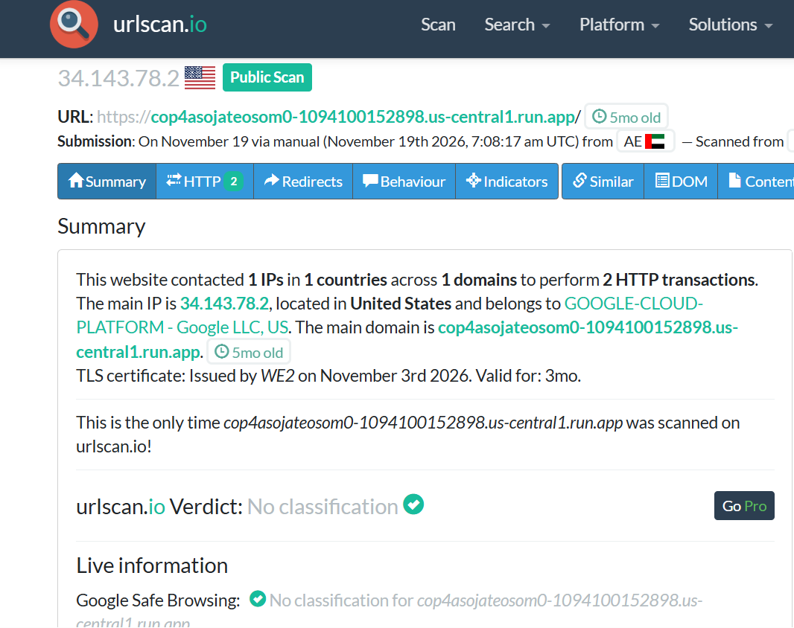

# Case 02: Fake Visa World Cup Prize Promotion

| Field | Detail |
|---|---|
| Sample source | Phishing Pot (public research repository), file: sample-100.eml |
| Email date | 2026-07-06 (UTC) |
| Analysis date | 2026-11-19 |
| Verdict | Phishing (brand impersonation, fake prize promotion) |
| Severity | Medium |
| Confidence | High that the email is fraudulent; landing page not verified (returned 404) |

## Summary

A Portuguese-language email claims to be a Visa promotion for the 2026 World
Cup. It offers cash prizes of up to R$ 100,000, dinners, VIP rooms and trips
for purchases above R$ 10, and pushes the reader to click a "Quero
Participar" ("I want to participate") button. The sender address has no real
domain after the "@", the message carries no authentication or signature, and
it was sent from a rented cloud server in the UK, not from Visa. The button
links to a Google Cloud Run address instead of a Visa domain. Microsoft scored
the message SCL 7 (high-confidence spam) and delivered it to the Junk folder.

## Evidence

| # | Check | Finding | Why it matters |
|---|---|---|---|
| 1 | Sender identity | Display name "Visa", address nao-responder-Visa701035750@promocoes701035750 | The part after the "@" has no domain ending, so it is not a real domain and cannot belong to Visa |
| 2 | Return-Path / Reply-To | Return-Path matches From; Reply-To is suporte@notificacoes | Reply-To also has no real domain, so replies would go nowhere real |
| 3 | SPF | None (sender IP 95.179.194.86) | No domain exists to authorize any sending server |
| 4 | DKIM | None (message not signed) | The email carries no signature at all, unlike Case 01 where a signature existed but failed |
| 5 | DMARC | None | No policy applies |
| 6 | Originating server | Received line shows the sender as [127.0.0.1] with public IP 95.179.194.86 | 127.0.0.1 means "this computer", so the sending software gave itself a placeholder name |
| 7 | Mailer | X-Mailer: Custom Mailer v1.0 | A homemade bulk-mailing tool, not a recognized marketing platform |
| 8 | IP reputation | 95.179.194.86: 0%, The Constant Company (Vultr), data center, London | Rented cloud server, not Visa infrastructure; 0% only means no reports yet |
| 9 | Microsoft verdict | SCL 7, delivered to Junk | High-confidence spam by the provider's own filter (Case 01 scored 5) |
| 10 | Link destination | Button points to a Google Cloud Run address (run.app) | A Visa promotion would be hosted on a Visa domain; anyone can host a page on Cloud Run |
| 11 | Tracking tag | Link ends with a ?cid= value containing the recipient's address (anonymized in the sample) | Per-recipient tracking, typical of mass campaigns. Removed before scanning to avoid exposing it |
| 12 | Link scan (2026-11-19) | VirusTotal 0/93, HTTP 404; urlscan.io no classification, 2 requests, Google Cloud IP | Nothing flagged and no page found. Page content could not be inspected |
| 13 | Domain age | Not applicable | The sender has no real domain, and the link host is a subdomain of Google's run.app |
| 14 | Content | Cash prizes up to R$ 100,000 for purchases above R$ 10, draw dates, one "participate" button | Large reward for little effort, deadlines for pressure, one action pushed |

## Assessment of how the email was sent

The email came from a single public server, a rented cloud server in London,
and was handed straight to Microsoft. There is no relay through another
company. The malformed sender and reply addresses, the placeholder server
name and the custom mailer are consistent with a bulk mailer running on
rented infrastructure. This is an inference from the headers, not a
confirmed fact.

## Indicators of Compromise (IOCs)

| Type | Value | Note |
|---|---|---|
| Sender address | nao-responder-Visa701035750@promocoes701035750 | Display name "Visa"; no valid domain |
| Reply-To | suporte@notificacoes | No valid domain |
| Unsubscribe address | unsubscribe@notificacoes | mailto only; no valid domain |
| Originating IP | 95.179.194.86 | The Constant Company (Vultr), London |
| Originating host | 95.179.194.86.vultrusercontent[.]com | Provider's default name |
| URL | hxxps://cop4asojateosom0-1094100152898[.]us-central1[.]run[.]app/ | Query string removed; returned 404 at scan time |
| URL resolved IPs | 34.143.72.2, 34.143.78.2 | Google Cloud |
| Mailer | Custom Mailer v1.0 | X-Mailer header |
| Subject (Portuguese) | Copa 2026: Oportunidade de prêmio no valor de R$ 100.000,00 — ID: 152092200 | Useful for searching mail logs |

## Recommended Response

1. **Block the originating IP** 95.179.194.86 at the email gateway. It is a
   rented cloud address, so review the block later in case the IP is
   reassigned to a different customer.
2. **Block the sender and reply addresses** (nao-responder-Visa701035750@promocoes701035750,
   suporte@notificacoes). They have no valid domain, so this is low risk to legitimate mail.
3. **Block the URL** hxxps://cop4asojateosom0-1094100152898[.]us-central1[.]run[.]app/
   at the web proxy. Do not block all of run.app, which hosts many legitimate
   applications.
4. **Search mail logs** for the same subject or sender to find other recipients,
   and remove any copies from mailboxes.
5. **Report the page** to Google Cloud as abuse of Cloud Run, report the sending
   IP to its provider (The Constant Company / Vultr), and report the Visa
   impersonation to Visa's fraud reporting channel.
6. **If any user clicked or entered details:** reset passwords, tell the user to
   contact their bank and watch for fraudulent card activity, and check for
   follow-up scam calls or messages.
7. **User awareness:** remind staff that prize promotions arriving by email are
   a common lure, and that real offers can be checked by typing the company's
   address into the browser, not by clicking the email.

## Limitations

- The landing page returned 404 when scanned (2026-11-19), so it was not
  inspected. The query string was removed before scanning, so the page may only
  respond to the full tracking link. The cause of the 404 is unknown.
- The purpose of the page (for example collecting card or personal details) is
  inferred from the email content, not observed.
- I did not verify whether Visa ran a real World Cup promotion. The verdict
  rests on the sender and link evidence: the email did not come from Visa and
  did not link to a Visa domain.
- No evidence shows whether any recipient interacted with the email. It was
  delivered to Junk.
- The AbuseIPDB score of 0% means no reports, not that the IP is safe.

## Screenshots

| Evidence | File |
|---|---|
| AbuseIPDB: originating IP |  |
| VirusTotal: link |  |
| urlscan.io: link |  |

## Tools used

Raw header review in a text editor, AbuseIPDB, VirusTotal, urlscan.io.
