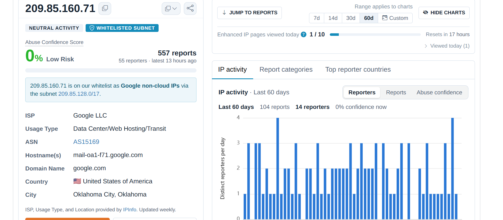
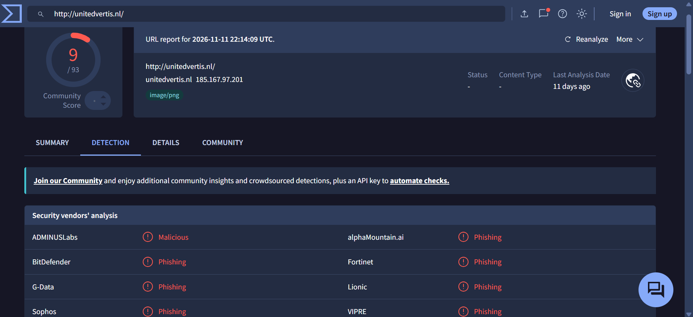
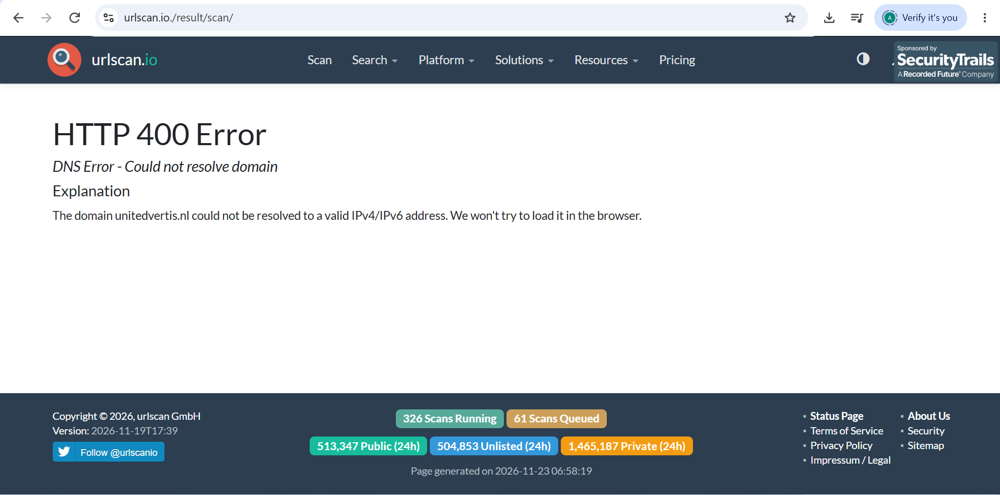

# Case 03: Casino Promotion Sent Through Firebase

| Field | Detail |
|---|---|
| Sample source | Phishing Pot (public research repository), file: sample-10009.eml |
| Email date | 2026-03-30 (UTC) |
| Analysis date | 2026-11-23 |
| Verdict | Malicious spam: unsolicited casino promotion, sent by abusing a trusted email service, with links to a domain flagged for phishing |
| Severity | Low |
| Confidence | High that the email is unsolicited and abusive; the link destination was not inspected (domain no longer resolved) |

## Summary

A German-language email promotes an online casino called "Casoola" with a
"100% up to 3500 EUR + 200 free spins" welcome offer. It was sent from a
Firebase address (firebaseapp.com) through Google's own mail servers, so it
passed SPF and DKIM. The authentication results therefore do not show fraud
here; they only show that Google's systems sent the message. Every clickable
part of the email points to a different domain, unitedvertis[.]nl, which nine
security vendors flagged on VirusTotal and which no longer resolved when
rechecked. The HTML also contains a hidden Firebase password-reset link, which
suggests the sender reused a Firebase system email. Microsoft scored the
message SCL 5 and delivered it to the Junk folder.

## Evidence

| # | Check | Finding | Why it matters |
|---|---|---|---|
| 1 | Sender identity | Display name "Casoola", address no-reply@casoola-2a91e.firebaseapp[.]com | The domain is a Firebase-hosted address. Anyone can create a Firebase project, so the name says nothing about who the real casino is |
| 2 | Return-Path / Reply-To | Return-Path matches From; no Reply-To | Nothing hidden here |
| 3 | SPF | Pass (sender IP 209.85.160.71) | Google's server is allowed to send for this Firebase address |
| 4 | DKIM | Pass, signed by firebaseapp.com | The signature is valid, which shows the message went through Firebase. It does not show the content is honest |
| 5 | DMARC | Permerror (action none); Microsoft's composite check (compauth) passed | Microsoft could not evaluate the DMARC policy. This is neither pass nor fail |
| 6 | Originating server | mail-oa1-f71.google[.]com (209.85.160.71) handed the message directly to Microsoft | Google's own mail infrastructure; no third-party relay |
| 7 | IP reputation | AbuseIPDB 0%, whitelisted Google range, 557 reports from 55 reporters (latest about 13 hours before the check) | The low score comes from the whitelist, not from a lack of reports. Report categories were not recorded |
| 8 | Microsoft verdict | SCL 5, delivered to Junk | Microsoft judged it as spam even though the authentication checks passed |
| 9 | Link destinations | Both buttons, and a further link opened before the page body, point to hxxp://unitedvertis[.]nl/fwd/ followed by a campaign code | The links go to a domain unrelated to the sender (firebaseapp.com). They use http, which is not encrypted |
| 10 | Unsubscribe and tracking | hxxp://unitedvertis[.]nl/unsub/ (campaign code only) and a 1x1 image at hxxp://unitedvertis[.]nl/open/ ending with the recipient's address (anonymized in the sample) | The invisible image tells the sender when the email is opened |
| 11 | Image hosting | Logo and pictures load from imgprom[.]com and img.icons8[.]com | Brand images are hosted on third-party sites, not on a casino domain |
| 12 | Domain reputation | unitedvertis[.]nl: VirusTotal 9/93, report dated 2026-11-11, labelled malicious and phishing by several vendors, IP 185.167.97.201 | Reflects the domain's reputation, not the content of this email's page |
| 13 | Domain resolution | urlscan.io on 2026-11-23: DNS error, domain could not be resolved | The domain resolved on 2026-11-11 (VirusTotal had an IP) and no longer did. Cause unknown. The destination was never inspected |
| 14 | Hidden content | A Firebase password-reset style link sits inside a style element, invisible to the reader | Suggests the sender reused a Firebase system email. Not scanned or recorded, because it contains a one-time code and a key |
| 15 | Content | German casino welcome offer ("100% up to 3500 EUR + 200 free spins"), new players only, one action: "get bonus now" | Unsolicited promotion pushing a click |

## Assessment of how the email was sent

The message left through Google's mail servers using a Firebase project address,
which is why SPF and DKIM passed. The hidden password-reset style link suggests
the sender may have reused Firebase's own email feature to send promotional
content, but this is an inference from the HTML, not a confirmed fact. The
clickable parts all lead to a separate domain with a poor reputation, and that
domain, not the sender, is the main indicator of abuse.

## Indicators of Compromise (IOCs)

| Type | Value | Note |
|---|---|---|
| Sender address | no-reply@casoola-2a91e.firebaseapp[.]com | Display name "Casoola" |
| Firebase project ID | casoola-2a91e | Useful when reporting abuse to Google |
| Sending IP | 209.85.160.71 | Shared Google mail server. Do not block |
| Link domain | unitedvertis[.]nl | Flagged by 9 vendors; no longer resolving on 2026-11-23 |
| Link paths | hxxp://unitedvertis[.]nl/fwd/, /unsub/, /open/ | Campaign codes removed |
| Domain IP (historical) | 185.167.97.201 | From VirusTotal, 2026-11-11 |
| Image host | imgprom[.]com | Observed, not assessed |
| Message-ID | 000000000000feeb01064e3deead@google.com | Generated by Google; useful for log searches |
| Subject (German) | Starte mit einem starken Willkommenspaket: 100% bis zu 3500 EUR + 200 Freispiele, um deine Chancen zu erhöhen! | Useful for log searches |

## Recommended Response

1. **Block the link domain** unitedvertis[.]nl at the web proxy or DNS filter.
   Nine vendors flagged it and it carries the campaign, unsubscribe and
   tracking paths.
2. **Do not block 209.85.160.71 or google[.]com mail servers.** They are shared
   Google infrastructure that sends large volumes of legitimate mail. Blocking
   them would cause false positives.
3. **Block the sender address** no-reply@casoola-2a91e.firebaseapp[.]com. Avoid
   blocking all of firebaseapp[.]com, which hosts many legitimate projects.
4. **Search mail logs** for the same subject or sender address to find other
   recipients, and remove any copies from mailboxes.
5. **Report the abuse to Google** (Firebase project casoola-2a91e) so the
   project can be reviewed, and mention that its system email appears to have
   been used for promotional mail.
6. **Do not use the hidden password-reset style link.** It was left unscanned
   and unrecorded on purpose.
7. **If a user clicked through:** advise them not to enter personal or payment
   details on the destination, and check for follow-up scam messages.
8. **User awareness:** remind staff that an email passing SPF and DKIM is not
   proof of trustworthiness, and that unsolicited promotions should be
   deleted, not answered or unsubscribed from.

## Limitations

- The link destination was never inspected. The domain resolved on 2026-11-11
  (VirusTotal) and returned a DNS error on 2026-11-23 (urlscan.io). The cause
  of the change is unknown.
- The VirusTotal result is dated 2026-11-11, not the day of analysis.
- AbuseIPDB report categories for the Google IP were not recorded, so the
  nature of the 557 reports is unknown.
- I did not verify whether the real Casoola casino was involved in sending
  this message.
- The reason for the DMARC permerror was not investigated.
- The hidden password-reset style link was not tested. The explanation that
  the sender reused a Firebase system email is an inference from the HTML.
- Nothing in the email shows whether any recipient interacted with it. It was
  delivered to Junk.

## Screenshots

| Evidence | File |
|---|---|
| AbuseIPDB: sending IP |  |
| VirusTotal: link domain |  |
| urlscan.io: link domain |  |

## Tools used

Raw header and HTML review in a text editor, AbuseIPDB, VirusTotal, urlscan.io.
